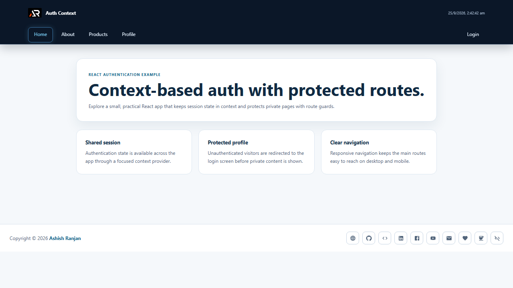

# React Auth Context Demo

A browser-only learning project that demonstrates React Context state, local session persistence, and a client-side protected route.



## Features

- Context provider with demo login and logout
- Sample email saved in browser local storage
- Protected profile route with return-to-login navigation
- Responsive layout built with React Router and Material UI

## Run locally

```sh
npm install
npm start
```

Use the sample account shown on the login page:

- Email: `user1@mail.com`
- Password: `P@$$w0rd`

## Security boundary

This is a mock authentication example, not a secure login system. The sample credentials are checked in client-side code, and the profile route can be bypassed by editing browser storage or application state. It has no authentication server, password hashing, or access control for real data. Do not use this pattern to protect private information.

## Deploy

Run `npm run deploy` to create a production build, prepare the GitHub Pages route fallback, and publish the site.

## Links

- Live app: [a2rp.github.io/react-auth-context](https://a2rp.github.io/react-auth-context/)
- Repository: [github.com/a2rp/react-auth-context](https://github.com/a2rp/react-auth-context)
- Portfolio: [ashishranjan.net](https://www.ashishranjan.net/)
